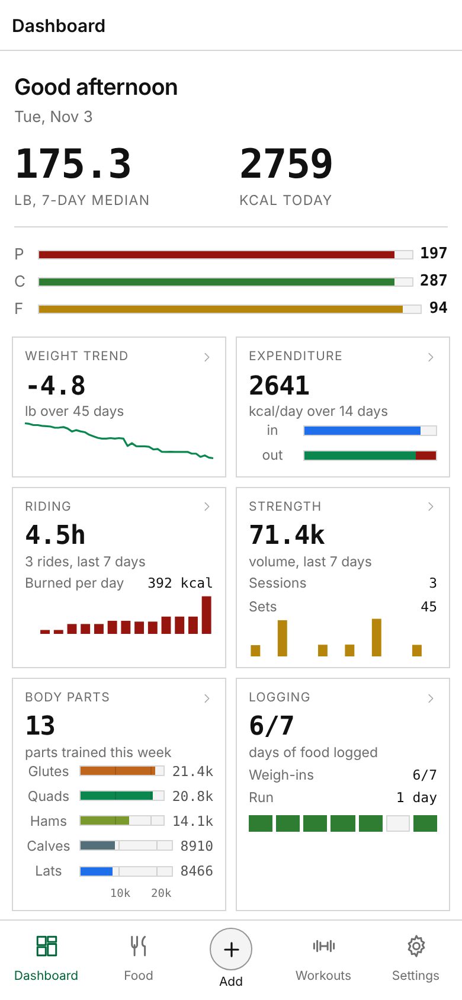
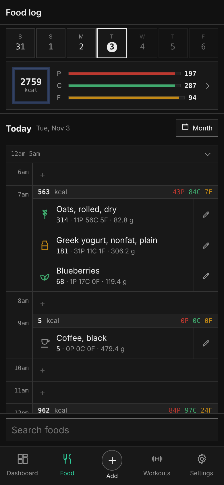
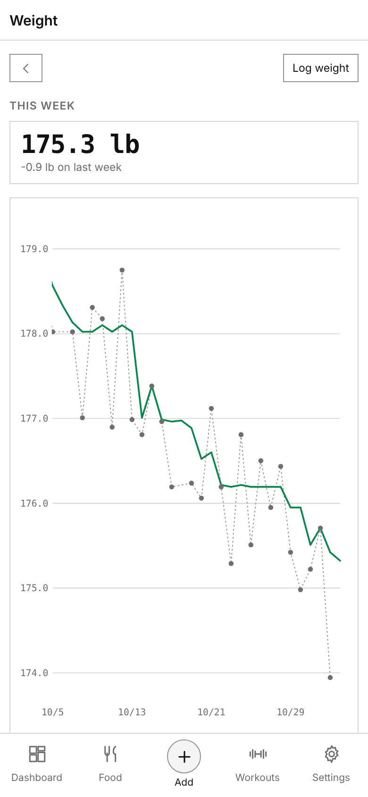
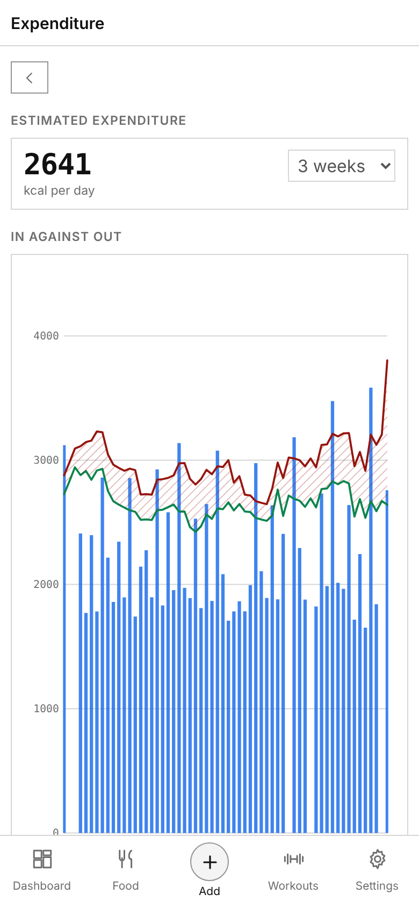
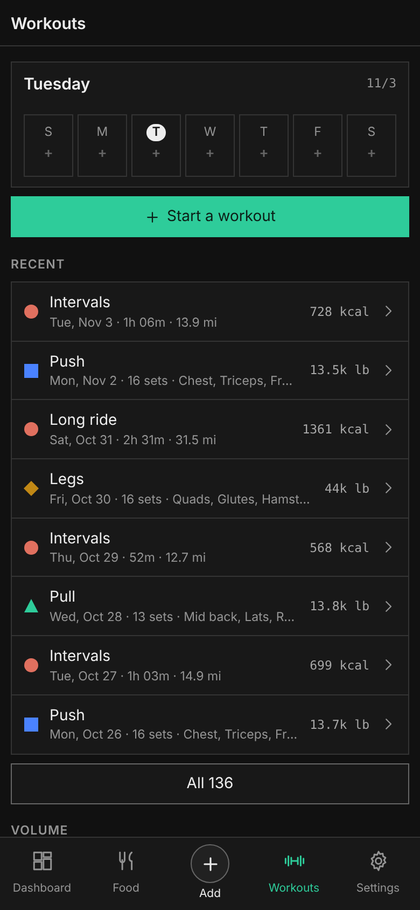
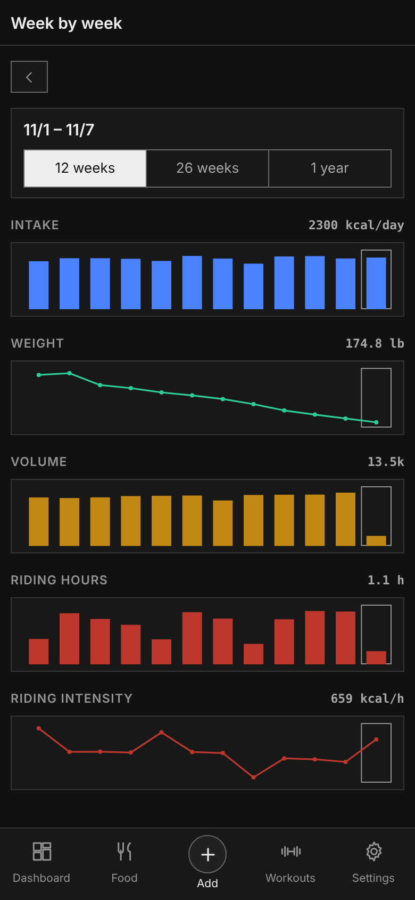

# Squid

A personal tracker for bodyweight, food, cardio and strength, built to live on a phone's home screen. Log what you eat and how you train in a few taps, and Squid works out what it adds up to: your weight trend, what you actually burn, and how each week compares with the last.

<p>
  
  
  
</p>
<p>
  
  
  
</p>

<sub>Screenshots use the app's built-in sample data. Regenerate them with `npm run screenshots`.</sub>

## What it does

**Food.** The log is the day laid out hour by hour, with each meal's calories, protein, carbs and fat beside it. Search puts the foods you log most first, so two letters usually find your staples. Build a meal on the plate and log it in one go, or use Quick add for a bare calorie number. Keep your own foods and recipes, and track alcohol separately from the three macros.

**Bodyweight.** Daily weigh-ins sit under a 7-day median, so one salty dinner doesn't move the number you look at. The weight dial centres on your own recent readings, and a reading far from them asks you to check it before saving.

**Expenditure.** Squid estimates what you burn from what you ate and how your weight moved over the same weeks. No step counts, no activity multipliers. The longer you log, the better the estimate.

**Training.** Strength sessions run from your own workouts and exercises, grouped by body part, with a body-parts card showing what you trained this week. Pick the metric that matches how you train: effective reps, volume, load over time, or sessions only. Cardio covers rides, runs, rows, swims and walks, each tracking the metrics you choose (distance, heart rate, power, MET), with energy worked out from power or MET and bodyweight.

**Weekly view.** Week by week lines intake, weight, training and cardio up on calendar weeks across 12 weeks, 26 or a year. The weekly summary reads back the last seven days, and the logging page shows which days have food and weigh-ins.

**Progress photos.** Front, side and back photos per session, kept with the rest of your record.

**Claude, optional.** With an Anthropic API key configured, describe a meal in words or speech and it lands on the plate, look up a packaged food you don't have, generate a recipe, or get a written read of your week. Without a key these controls stay hidden.

**Shaped around you.** Onboarding takes about a minute: switch food, bodyweight, strength and cardio on or off, pick your units (kg or lb, km or miles, kcal or kJ) and your first day of the week. Anything you don't track disappears from the tabs, the dashboard and Settings. Hold a section to reorder or hide it, and restyle the whole app in the theme editor.

**Your data.** Every change syncs live to every open device and stays readable offline. Full backups download as one file and restore with Replace or Add what's missing. MacroFactor exports and generic CSVs import, and the log exports as CSV.

## Who it's for

One person who wants their numbers in one place: someone cutting, maintaining or gaining who wants to know what they burn instead of guessing, a lifter who also rides or runs, or anyone moving off MacroFactor who wants their history to come with them. There is no coaching, no social feed and no streak nagging. It shows what happened and leaves the decisions to you.

## How it runs

One Cloudflare Worker serves the app and a small API. Each account's records live in their own Durable Object and sync live to every open device over a WebSocket. Sign-in goes through Cloudflare Access once, then Squid's own session keeps a Home Screen app signed in for 400 days from its last use. AI calls go through the Worker, so the API key never reaches the browser. See [docs/architecture.md](docs/architecture.md), and [docs/roadmap.md](docs/roadmap.md) for what comes next.

## Develop

Node 22.

```sh
npm install
printf 'ENV=dev\nDEV_EMAIL=you@example.com\n' > .dev.vars   # local sign-in; never used in production
npm run dev                                                  # http://localhost:8787
npm test                                                     # Worker tests (workerd)
npm run test:e2e                                             # Chromium against wrangler dev, synthetic data
npm run screenshots                                          # README screenshots from the app's sample data
```

## First deploy

The repo deploys from GitHub Actions on every push to `main` once Cloudflare credentials are in place. Until then the Deploy workflow runs the tests and skips the deploy with a warning.

1. **API token.** Cloudflare dashboard → My Profile → API Tokens → Create Token → template "Edit Cloudflare Workers", limited to your account. In GitHub → Settings → Secrets and variables → Actions, add `CLOUDFLARE_API_TOKEN` (the token) and `CLOUDFLARE_ACCOUNT_ID` (Workers & Pages → Account details).
2. **First deploy.** GitHub → Actions → Deploy → Run workflow (or push to `main`). This creates the `squidfit` Worker at `https://squidfit.<your-subdomain>.workers.dev`. The API answers 503 until step 4 is done, so nothing is reachable yet.
3. **Access.** Workers & Pages → squidfit → Settings → Domains & Routes → workers.dev → Enable Cloudflare Access. Then, in Zero Trust → Access → Applications → the squidfit application:
   - Narrow it to the sign-in path: set the public hostname's path to `auth`. Squid checks its own session everywhere else; a Home Screen app on iOS cannot finish a sign-in on Access's domain, so Access must not sit in front of the page.
   - Add a login method you can use on a phone: Zero Trust → Settings → Authentication → Login methods → One-time PIN (optionally Google). Make sure the squidfit application offers it. The default "Cloudflare" method signs in with your Cloudflare dashboard account, under whatever email that account uses.
   - Set the policy to Allow → Include → Emails → the exact address you will sign in with. "That account does not have access" on the Access page means the identity you signed in as is not in this policy.
   - Copy the application's AUD tag. (The Access session length no longer matters: Squid's own session lasts 400 days from its last use.)
4. **Worker secrets** (Workers & Pages → squidfit → Settings → Variables and Secrets, type Secret), or `npx wrangler secret put NAME`:
   - `ALLOWED_EMAIL`: the same address as the Access policy (comma-separate to allow more than one)
   - `ACCESS_TEAM_DOMAIN`: your current Zero Trust team name, which is the host of the Access sign-in page (`<team>.cloudflareaccess.com`). If you renamed the team, use the new name.
   - `ACCESS_AUD`: the AUD tag from step 3
   - `ANTHROPIC_API_KEY`: a key from the Anthropic Console, ideally in its own workspace with a monthly spend limit. Without it the AI features stay hidden.
5. **Move your data.** Open the Worker URL, sign in, skip onboarding, then Settings → Data → Restore a Squid backup → choose your Full backup → Replace everything.
6. **Install.** Sign in in Safari first, then Share → Add to Home Screen; the Home Screen app takes Safari's sign-in with it. Re-set the per-device settings (light/dark, text size, density, swipe, dial speed); they don't travel between origins.

Optional: a QA copy (`squidfit-qa`, Haiku on every tier, import/reset endpoints enabled) deploys with the Deploy workflow's `env: qa` input and needs the same Access and secrets steps.

## Layout

```
src/app/        the app, classic scripts concatenated in order
src/host/       window.claude.use(db|sample|downloads) on Cloudflare
src/index.html  page template
worker/         Worker routes, sign-in (Access, then Squid's session), AI proxy, Account Durable Object
public/         manifest, icons, _headers
test/           worker tests and end-to-end
scripts/        build, artifact import, README screenshots
docs/           architecture, roadmap, screenshots, artifact-era history
```
